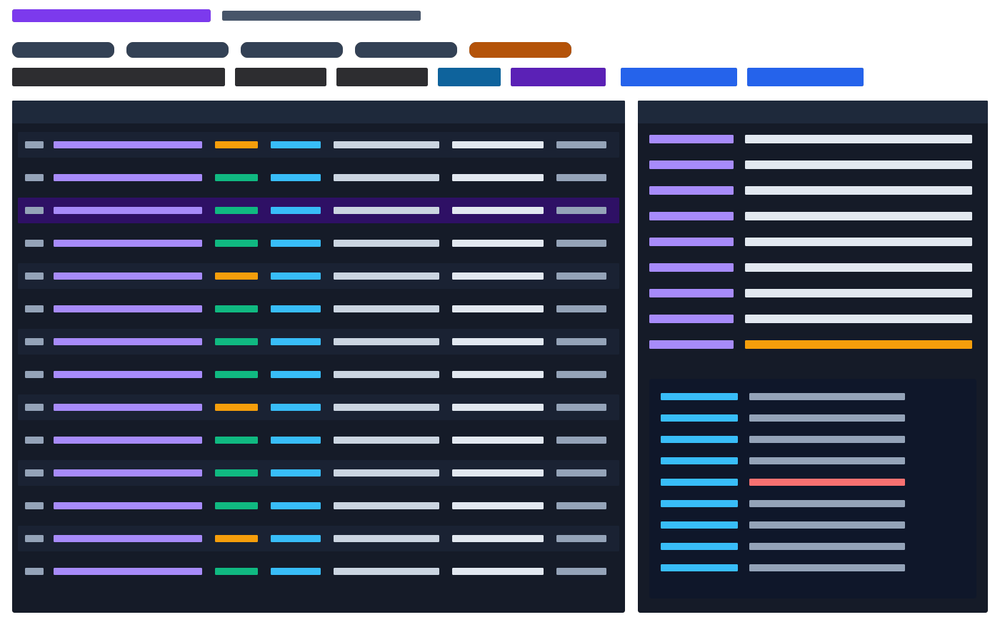

# Terraform State & Plan Viewer for VS Code

Open Terraform state and plan JSON files in the editor. Raw `.tfstate` and `.tfplan.json` files store resource attributes, dependency arrays, outputs and sensitive values inside large nested JSON documents, so checking infrastructure changes as plain text takes time and invites mistakes. This extension parses Terraform state v3, state v4 and `terraform show -json` plan files locally with plain JavaScript, without an external binary or cloud upload.

## What it opens

- Terraform state files (`.tfstate`, `.tfstate.backup`) in format version 4 and legacy version 3.
- Terraform JSON plan files (`.tfplan.json`, created with `terraform show -json`).
- Nothing to install, nothing uploaded.

## The free part

- Resource inventory table: lists every resource instance with address, mode or plan action, provider, type, name, module, dependency count and sensitive flag.
- Outputs tab: displays all state outputs and planned output changes with type, sensitive status and masked or unmasked values.
- Dependencies tab: lists every resource dependency edge and marks orphaned dependencies whose target resource is missing from the state.
- Sensitive-value masking toggle: masks values flagged by `sensitive_attributes` or matching secret key names by default, with a toolbar toggle to reveal values locally.
- Search, filter and state health findings: filter resources by text, provider, module or mode, and check for orphaned dependencies, plaintext sensitive attributes, tainted resources, public network rules (`0.0.0.0/0`), wildcard IAM permissions and legacy state versions.

## The Pro tools, with 1 free try

Pro adds the comparison, audit and export steps: compare two `.tfstate` or `.tfplan.json` files in a Markdown drift report, audit sensitive attributes and public exposure or IAM risks across a file or folder in Markdown, or export resources CSV, outputs CSV, structured JSON and a Mermaid dependency graph locally. Your first try of each Pro tool is free. Zovo Pro is USD 19 once, and the team licence is USD 59.

## Why not raw JSON

Terraform state files contain credentials, private IPs and internal account IDs, so uploading them to an online JSON viewer is a security risk. Reading raw state JSON inside a text editor also makes it hard to trace dependencies or spot an orphaned reference before applying a change. A local resource table with masked attributes, dependency edges and health findings shows the state on one screen, offline.

## More tools by Zovo

See full docs and install options at [vscode.zovo.one/extensions/zovo-tfstate-viewer/](https://vscode.zovo.one/extensions/zovo-tfstate-viewer/), browse all Zovo VS Code extensions at [vscode.zovo.one](https://vscode.zovo.one/), or explore [Zovo Pro](https://vscode.zovo.one/pro/).
